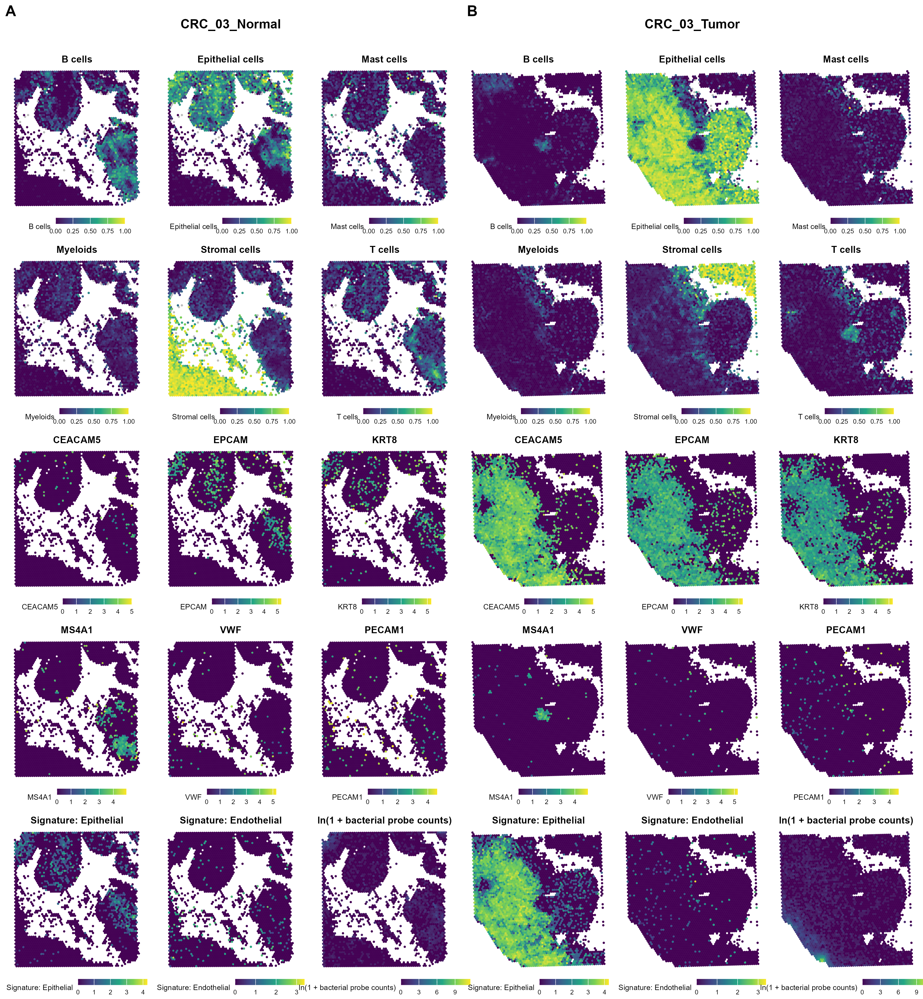

# Colorectal Cancer: Single-Cell and Spatial Host–Bacteria Analysis

An R workflow integrating **single-cell RNA sequencing** and **spatial transcriptomics** to investigate cell composition, bacterial signals, and spatial host–bacteria associations in colorectal cancer.

## Datasets

- **GSE132465:** Single-cell RNA-seq reference, retaining 10 matched normal–tumor patient pairs.
- **GSE334323:** Four spatial sections from two matched normal–tumor patient pairs: `CRC_03` and `CRC_08`.

The single-cell reference supports spatial cell-type deconvolution using **RCTD**.

## Datasets

## Workflow

| Stage | Script | Purpose |
| :---: | --- | --- |
| 01 | `01_Data_Preprocessing.R` | Data import, metadata validation, and quality control |
| 02 | `02_Cell_Annotation.R` | Normalization, clustering, marker detection, and cell-type annotation |
| 03 | `03_Cell_Composition.R` | Paired cell-type and subtype composition comparisons |
| 04 | `04_Spatial_Host_Profiling.R` | Spatial preprocessing, host/bacterial signal separation, RCTD, and feature mapping |
| 05 | `05_Bacteria_Host_Association.R` | Spatial associations between bacterial signals and selected host features |
| 06 | `06_Paired_Bacterial_Changes.R` | Descriptive normal–tumor changes across 19 bacterial groups |
| 07 | `07_Bacterial_Spatial_Cooccurrence.R` | Exploratory bacterial spatial co-occurrence analysis |

## Requirements

**R** with the following packages:

- **Single-cell analysis:** Seurat, SeuratObject, SingleR, celldex, SingleCellExperiment, BiocParallel
- **Spatial analysis:** spacexr, RANN, SpatialPack
- **Data handling:** Matrix, data.table, R.utils, digest
- **Visualization:** ggplot2, patchwork, cowplot
